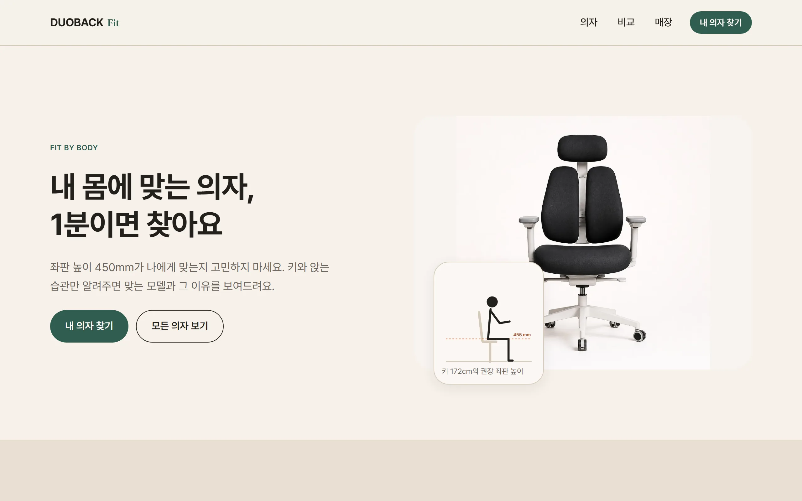
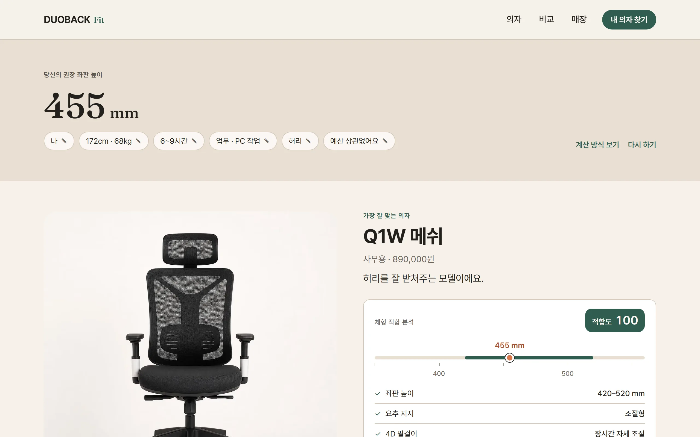
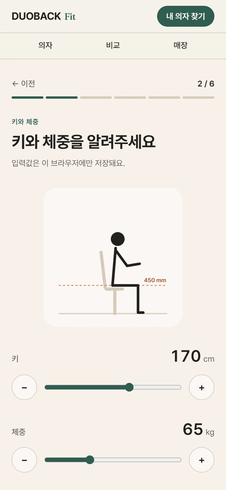
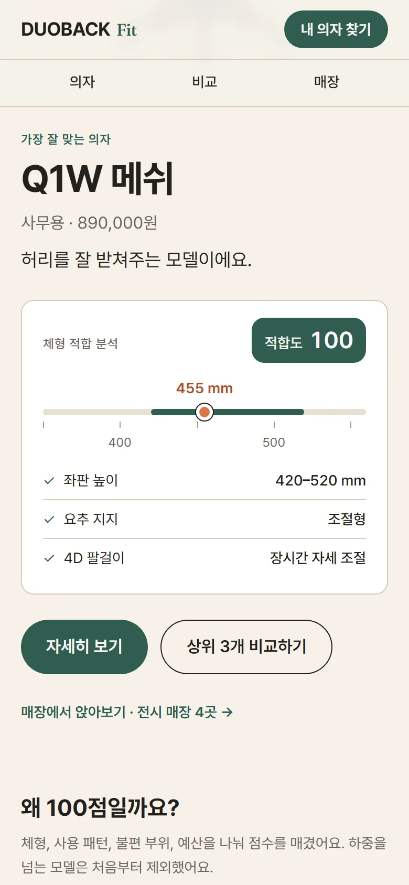
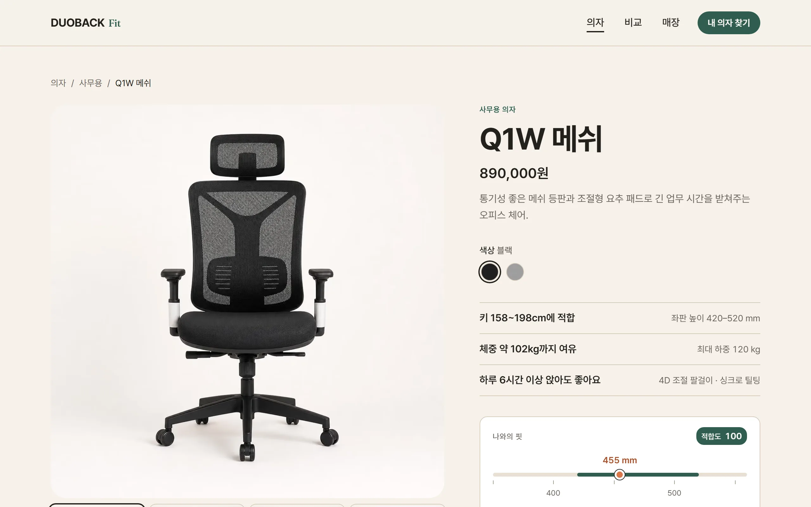
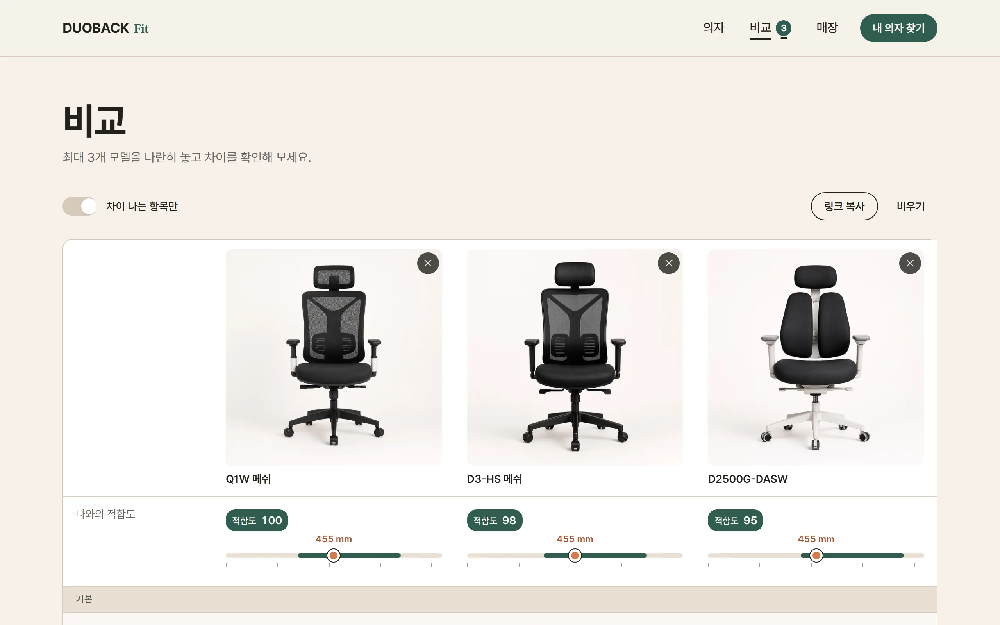
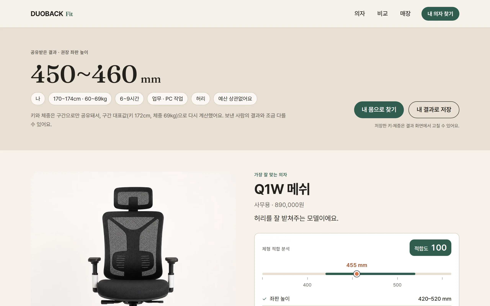

# DUOBACK Fit

**배포:** https://duoback-fit.vercel.app

키와 체중, 앉는 습관을 알려주면 내 몸에 맞는 의자와 **그 이유**를 보여주는 의자 쇼룸 사이트입니다.
기존 React SPA 쇼핑몰 프로젝트(duoback-react)를 기획부터 다시 설계한 포트폴리오 프로젝트입니다.

> 제품 정보와 스펙은 포트폴리오용 가상 데이터이며 실제 브랜드·제품과 관련이 없습니다.



## 화면

<table>
  <tr>
    <td width="60%"></td>
    <td width="20%"></td>
    <td width="20%"></td>
  </tr>
  <tr>
    <td>Fit 결과: 권장 좌판 높이와 모델별 적합도, 그 근거</td>
    <td>질문 6개 중 키·체중</td>
    <td>결과의 데이터 카드</td>
  </tr>
</table>

<table>
  <tr>
    <td width="50%"></td>
    <td width="50%"></td>
  </tr>
  <tr>
    <td>의자 상세: 스펙을 몸 기준으로 다시 쓰고, 저장된 프로필로 "나와의 핏" 표시</td>
    <td>비교: 최대 3개 모델, 나와의 적합도와 차이 나는 항목</td>
  </tr>
</table>

<table>
  <tr>
    <td width="60%"></td>
    <td width="40%">
      <b>공유받은 결과</b><br><br>
      링크에는 키·체중이 5cm·10kg 구간으로만 담깁니다(<code>?share=1-s-170-60-6-w-lb-any</code>).
      받은 쪽은 구간 대표값으로 다시 계산하고, 정확한 좌판 높이로 키가 역산되지 않게 범위로만 보여줍니다.
      보는 사람의 저장된 프로필은 건드리지 않습니다.
    </td>
  </tr>
</table>

## 풀려는 문제

"좌판 높이 450~550mm, 4D 팔걸이, 최대 하중 120kg" 같은 스펙은 의자 기준으로 쓰여 있어서,
사용자는 이 숫자가 **내 몸에 맞는지** 판단할 수 없습니다. DUOBACK Fit은 몸 정보를 받아 권장 좌판 높이를 계산하고,
모델마다 적합도와 근거를 공개합니다.

## 주요 기능

- **Fit Finder:** 질문 6개 → 권장 좌판 높이 계산 → 모델별 적합도(100점)와 근거 체크리스트
- **점수 구성 공개:** 체형 40 · 사용 패턴 25 · 불편 부위 25 · 예산 10. 계산식은 `/fit/method`에 공개
- **결과 공유:** 키·체중을 5cm·10kg 구간으로만 담은 링크(`/fit/result?share=1-s-170-60-6-w-lb-80`).
  받은 쪽은 구간 대표값(키 중앙, 체중 상한)으로 다시 계산하고, 키가 역산되지 않게 좌판 높이는 범위로만 보여줌. 보는 사람의 프로필은 건드리지 않음
- **내 정보 지우기:** 결과 화면에서 저장된 키·체중과 답변을 지우고, 토스트에서 되돌릴 수 있음
- **몸 기준 스펙:** "좌판 420–520mm" 옆에 "키 158~198cm에 적합"처럼 사람 기준 해석을 함께 표기
- **의자 목록·상세:** URL과 동기화되는 필터·정렬, 색상 × 각도 갤러리, 저장된 프로필 기반 "나와의 핏"
- **비교:** 최대 3개 모델을 나란히 비교. 차이 나는 항목과 가장 유리한 값 표시, "차이 나는 항목만" 보기,
  `/compare?m=…` 공유 링크, 하단 비교 트레이, 되돌리기가 있는 토스트
- **매장 안내:** 모델별 전시 매장 필터(`/stores?model=…`), Fit 결과 1순위 모델을 전시한 매장 표시,
  상세·결과 페이지에서 "전시 매장 N곳"으로 연결

## 설계 결정

**1. 스펙을 몸 기준으로 다시 쓴다.**
사용자는 "좌판 420–520mm"를 자기 몸에 대입하지 못합니다. 권장 좌판 높이를 `키(cm) × 2.5 + 25 = 좌판 높이(mm)`로 계산하고(앉았을 때 오금 높이 ≈ 키의 25%, 신발 두께 25mm),
반대로 의자의 조절 범위에서 "키 158~198cm에 적합"을 역산해 스펙 옆에 함께 씁니다.

**2. 추천 이유와 계산식을 모두 공개한다.**
"추천합니다"만으로는 비싼 의자를 사지 않습니다. 100점을 체형 40 · 사용 패턴 25 · 불편 부위 25 · 예산 10으로 나누고, 점수마다 근거(✓ 요추 지지 조절형)를 보여줍니다.
계산은 같은 답변이면 항상 같은 결과가 나오는 순수 함수이고(단위 테스트로 고정), `/fit/method`에 계산식과 한계까지 공개합니다. 최대 하중을 넘는 모델은 감점이 아니라 결과에서 제외합니다.

**3. 브랜드는 따뜻하게, 데이터는 정확하게: 두 개의 디자인 레이어.**
화면을 브랜드 레이어(종이 톤 배경, 큰 라운드, 대화형 문장)와 데이터 레이어(흰 데이터 카드, 눈금, 고정폭 숫자, 체크리스트)로 나눴습니다.
데이터는 항상 흰 카드 안에 두고, 색은 moss 계열 하나의 단계로만 표현하며, 큰 디스플레이 숫자(455mm)는 한 화면에 하나만 씁니다.
흰 카드 위에서는 내 위치를 표시하는 clay 마커가 비텍스트 대비 3:1을 통과한다는 접근성상 이유도 있습니다. 토큰과 규칙은 [UI 스펙](docs/04-ui-spec.md)에 있습니다.

**4. 서버 없이 개인화한다.**
모든 페이지는 정적으로 생성하고, 개인화(프로필, 진행 중 답변, 비교 목록)는 브라우저 저장소에만 둡니다. 입력한 키와 체중은 서버로 가지 않습니다.
`useSyncExternalStore` 스토어는 하이드레이션 전 값을 `undefined`(아직 모름)로 구분해 "프로필 없음" 화면이 잠깐 보였다 바뀌는 일을 막고, 저장소 값은 손상·조작될 수 있어 읽을 때마다 검증합니다.

**5. URL을 상태로 쓴다.**
의자 필터·정렬(`/chairs?category=…&sort=…`), 비교(`/compare?m=q1w,d3hs`), 매장 필터(`/stores?model=…`), Fit 단계(`/fit?step=3`)를 모두 URL에 둡니다.
링크로 공유할 수 있고, 새로고침과 뒤로 가기에서도 상태가 유지됩니다.

**6. 구매 대신 "직접 앉아보기"로 흐름을 끝낸다.**
의자는 결국 앉아봐야 압니다. 장바구니·결제는 범위에서 빼고, 결과 1순위 모델을 전시한 매장을 표시해 "몸 정보 → 추천 → 비교 → 매장"을 하나의 흐름으로 이었습니다.

**7. 품질 기준을 CI가 지킨다.**
접근성(axe WCAG 2.1 AA, 제목 단계), 데스크톱·모바일 E2E, Lighthouse(성능 90 이상, 접근성·권장사항·SEO 100)를 모든 PR의 필수 검사로 둡니다.
성능은 측정으로 원인을 확인한 뒤 고쳤습니다. 과정은 아래 [성능](#성능)에 있습니다.

## 기술 스택

| 영역 | 선택 |
|---|---|
| 프레임워크 | Next.js 16 (App Router, Turbopack) · React 19 · TypeScript |
| 렌더링 | 모든 페이지 정적 생성. 상품 상세는 `generateStaticParams` + `dynamicParams = false` |
| 스타일 | Tailwind CSS v4 — `@theme` 토큰이 디자인 스펙(`docs/04-ui-spec.md`)과 1:1 대응 |
| 데이터 | 타입이 지정된 정적 데이터 (`src/data/chairs.ts`). zod 스키마는 테스트에서만 데이터를 검증하고, 브라우저 저장소 값은 손으로 쓴 파서가 검증(시드 고정 대조 테스트로 zod와 같은 판정을 보장). ESLint가 앱 코드의 zod import를 막음 |
| 상태 | `useSyncExternalStore` 기반 Web Storage 스토어 (프로필: localStorage, 진행 중 답변: sessionStorage) |
| 테스트 | Vitest — 매칭 로직과 데이터 정합성 · Playwright — 주요 사용 흐름, axe 접근성 검사(WCAG 2.1 AA), SEO 메타데이터 |
| SEO | 페이지별 메타데이터, canonical, JSON-LD `Product`, sitemap, robots |
| OG 이미지 | `next/og`로 사이트·상품별 1200×630 이미지를 빌드 시 정적 생성. 상품 이미지에 권장 키·좌판 높이 게이지 표시 |
| CI | GitHub Actions: lint → typecheck → test → build → 폰트 글자 검사 → E2E (실패 시 Playwright 리포트를 아티팩트로 업로드). 병렬 작업으로 Lighthouse 성능 회귀 검사(결과 표는 실행 요약, 리포트는 아티팩트) |

## 성능

운영 사이트를 Lighthouse 13.5(모바일, 기본 시뮬레이션 스로틀링)로 측정한 결과입니다. 페이지당 3회 측정한 중앙값이며, 처음 값만 1회 측정입니다.

| 페이지 | 처음 | 폰트 자체 호스팅·AVIF | 클라이언트 JS 감량 | 폰트 서브셋 1개 | LCP (처음 → 지금) |
|---|---|---|---|---|---|
| `/` | 77 | 81 | 88 | **97** | 4.5s → 2.3s |
| `/chairs` | 76 | 81 | 84 | **94** | 4.8s → 2.8s |
| `/chairs/q1w` | 74 | 80 | 84 | **97** | 5.1s → 2.4s |
| `/fit` | 81 | 89 | 88 | **96** | 4.1s → 2.4s |
| `/fit/method` | 76 | 76 | 77 | **98** | 4.5s → 2.3s |
| `/compare` | 79 | 86 | 88 | **97** | 4.4s → 2.3s |
| `/stores` | 76 | 76 | 81 | **97** | 4.8s → 2.5s |

접근성·권장사항·SEO는 모든 페이지가 100입니다(`/compare`는 쿼리 조합 페이지라 의도적으로 `noindex`여서 SEO 63).

1. **폰트 자체 호스팅·AVIF:** Pretendard CDN `@import`를 같은 도메인 제공으로 바꿔 다른 도메인 연결과 CSS 연쇄 요청을 없앴습니다. 이미지는 AVIF로 제공합니다.
2. **클라이언트 JS 감량:** zod를 브라우저 번들에서 빼서 라우트당 JS를 171KB에서 150KB(gzip)로 줄였습니다. 메인 스레드 작업이 33~36% 줄었습니다.
3. **폰트 서브셋 1개:** Pretendard 요청만 막아 보는 실험에서 점수가 96~97로 올라, 남은 차이가 폰트 때문임을 확인했습니다.
   동적 서브셋은 레이아웃 뒤에야 필요한 조각 10~15개(250~380KB)를 요청해 첫 화면이 폰트를 기다렸습니다.
   지금은 사이트 글자만 남긴 80KB 파일 하나를 preload하고 `font-display: optional`로 그려서, 첫 화면(FCP)이 2.1~2.9초에서 0.8~0.9초가 됐습니다.

## 구조

```text
src/
  app/                 라우트 (/, /chairs, /chairs/[slug], /fit, /fit/result, /fit/method)
  components/
    brand/             브랜드 레이어 (BodySilhouette, CautionNote)
    data/              데이터 레이어 (DataCard, FitGauge, ScoreBadge, ReasonList, ScoreBreakdown)
    chairs/  fit/  site/  ui/
  data/chairs.ts       의자 데이터 (+ 정합성 테스트)
  lib/
    chairs/            스키마, 라벨, 파생 값
    fit/               프로필 스키마, 적합도 계산(score.ts + 테스트), 스토어
docs/                  기획 문서 (PRD, UX 플로우, 와이어프레임, UI 스펙)
```

## 실행

```bash
npm install
npm run dev
```

```bash
npm run lint        # ESLint
npm run typecheck   # 라우트 타입 생성 + tsc
npm test            # Vitest
npm run build       # 프로덕션 빌드
npm run test:e2e    # Playwright E2E (프로덕션 빌드를 3100 포트에 띄워 데스크톱·모바일로 실행)
npm run measure:js  # 빌드 후 라우트별 브라우저 JS 크기(원본·gzip) 측정
npm run lighthouse  # 빌드 후 주요 7개 페이지 Lighthouse 측정(3회 중앙값), 기준 미달 시 실패
npm run screenshots # 빌드 후 README 스크린샷(docs/screenshots/*.webp) 다시 찍기
```

### 화면 폰트

화면 본문은 사이트에 나오는 글자만 남긴 Pretendard 가변 폰트 파일 하나(`src/app/fonts/pretendard-site.woff2`, 약 80KB, 굵기 400~700)를 preload해서 씁니다.
`font-display: optional`이라 첫 화면까지 폰트가 오지 않으면 시스템 서체로 그리고 도중에 바꾸지 않습니다.
글자는 빌드 결과물(HTML·RSC·클라이언트 JS)에서 모으므로, 문구를 바꾼 뒤에는 다시 만들어 커밋합니다. 빠진 글자가 있으면 CI가 실패합니다.

```bash
npm run build && npm run fonts:web             # 서브셋과 글자 목록(pretendard-site.chars.txt) 재생성
npm run build && npm run fonts:web -- --check  # 빠진 글자 검사(CI)
```

### OG 이미지 폰트

OG 렌더러(Satori)는 woff2를 읽지 못해 otf가 필요한데, Pretendard 원본은 굵기당 약 1.5MB입니다.
`npm run fonts:og`가 KS X 1001 한글 2,350자 + ASCII만 남긴 서브셋(굵기당 약 350KB)을 `assets/fonts/`에 만듭니다.
서브셋에 없는 글자는 빈 칸으로 그려지므로, OG에 들어가는 문자열은 `src/lib/og/charset.test.ts`가 검사합니다.

사이트 주소는 `NEXT_PUBLIC_SITE_URL` → Vercel이 자동 제공하는 `VERCEL_PROJECT_PRODUCTION_URL` → `localhost` 순으로 정해집니다. 커스텀 도메인을 쓸 때만 `NEXT_PUBLIC_SITE_URL`을 설정하면 됩니다.
